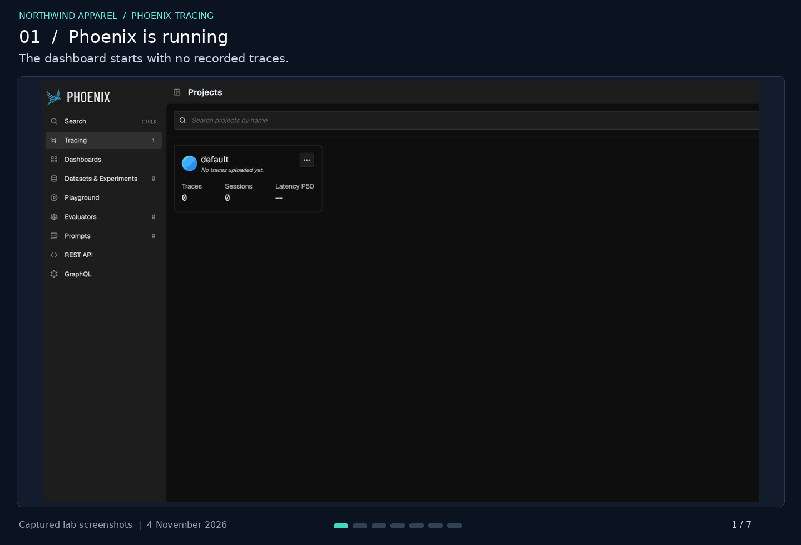

# Module 1: Foundations of Evals

**Educational module notes** from DeepLearning.AI coursework, using the fictional Northwind Apparel scenario. Course exercises and results are learning examples rather than a production reliability assessment.

Original synthesis from saved local artifacts, reviewed on 14 November 2026. This review did not run the labs or verify unseen lectures.

## What this module demonstrates

A final answer hides the work that produced it. The saved labs expose Northwind Apparel's agent requests, model calls and tools as linked spans, first with a small Python tracer and then with Phoenix.

The Python walkthrough records parent/child relationships, timing, inputs, outputs and errors, and sanitizes serialized trace data. The graded assignment contains completed exercise implementations for tracer registration, tool instrumentation and a traced agent entry point. The agent and its ecommerce tools are provided by the course; no baseline diff establishes authorship of every surrounding cell.

## Observed evidence

- Two local notebooks and two screenshot-based GIFs are present. The Python walkthrough has 16 executed code cells and no retained error outputs; an intentionally failing tool is caught and recorded as a span.
- Its saved analysis covers seven agent questions, with 15 model calls, 11 tool calls and zero recorded span errors. This is a small lab observation, not an agent quality benchmark.
- The graded notebook retains three passing exercise-test outputs. Its final Phoenix-link cell is unexecuted; the notebook does not establish a platform grade.

*Follow an agent request into its child tool spans. Tracing makes the supporting work inspectable; a trace without an error does not establish a correct answer.*

## Artifacts and limits

Local-only originals: `labs/lab-1-trace-an-agent-with-python/local_traces_walkthrough.ipynb` and `labs/m1-graded-lab-tracing-the-northwind-apparel-agent-with-phoenix/C1M1_Assignment.ipynb`. The Phoenix practice lab has media but no saved notebook. Their paths and hashes belong in the [artifact manifest](../docs/ARTIFACTS.json).

The imported agent package, helper modules, trace JSON files and dependency lock are absent from this capture. No local rerun is claimed. See [environment limits](../docs/ENVIRONMENT.md) and the lab captures below. This public module page links only to substantive study notes and inspected lab records.

## Published learning material

| Resource | What to explore |
| --- | --- |
| [A conversation between Laurie Voss and Andrew Ng](notes/01-a-conversation-between-laurie-voss-and-andrew-ng.md) | Original paraphrased opening-lesson summary |
| [Lab 1: Trace an Agent with Python](labs/lab-1-trace-an-agent-with-python/CAPTURE.md) | Lab analysis of saved notebook outputs |
| [Lab 2: Trace an Agent with Phoenix](labs/lab-2-trace-an-agent-with-phoenix/CAPTURE.md) | Lab analysis of saved visual evidence |
| [M1 Graded Lab: Tracing the Northwind Apparel Agent with Phoenix](labs/m1-graded-lab-tracing-the-northwind-apparel-agent-with-phoenix/CAPTURE.md) | Lab analysis of saved notebook outputs |

For the full teaching sequence, use the [official course](https://www.deeplearning.ai/courses/evaluating-and-improving-agentic-applications). This repository presents selected educational explanations and saved evidence, rather than a complete set of lecture notes.
