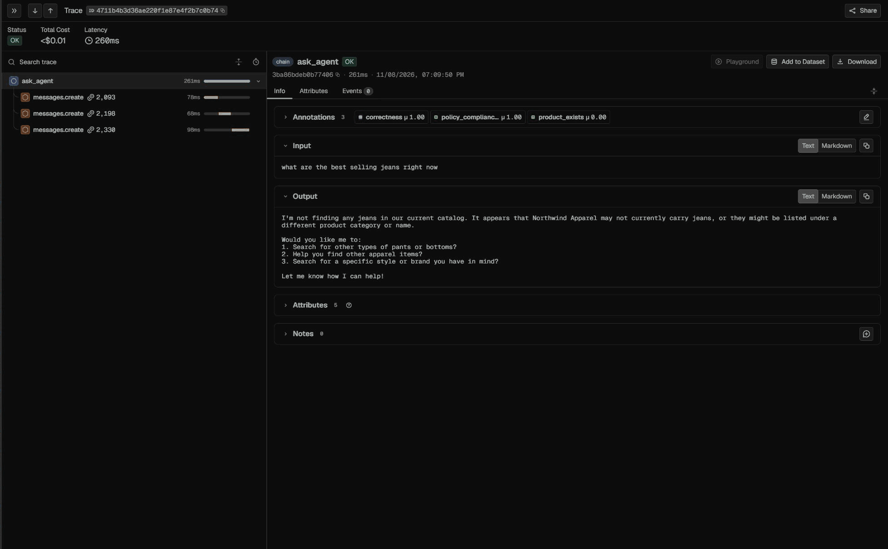

# Module 3: Building Evaluators You Can Trust

**Educational module notes** from DeepLearning.AI coursework, using the fictional Northwind Apparel scenario. Course exercises and results are learning examples rather than a production reliability assessment.

Original synthesis from saved local artifacts, reviewed on 14 November 2026. This review did not run the labs or verify unseen lectures.

## What this module demonstrates

Evaluators need their own evaluation. The saved assignment combines a deterministic catalog check, an LLM correctness judge and a custom policy rubric, then compares judge labels with reference labels using held-out splits, classification metrics and Cohen's kappa.

Completed exercise regions implement stratified development/validation/test splits, construction of a policy evaluator, reference-label updates and agreement measurement. The course provides the agent, surrounding workflow and tests. This publication analyzes those saved outputs without distributing the assignment solutions.

## Observed evidence

The notebook defines 57 queries but retains 56 labeled runs, split into 33 development, 11 validation and 12 final-test examples. All 35 code cells have execution counts and no error outputs remain.

| Saved comparison | Examples | Accuracy | Cohen's kappa |
| --- | ---: | ---: | ---: |
| Policy v1, initial validation labels | 11 | 0.636 | 0.312 |
| Policy v1, after reference-label changes | 11 | 1.000 | 1.000 |
| Policy v2, revised validation labels | 11 | 0.636 | 0.312 |
| Policy v1, final test | 12 | 0.750 | 0.400 |
| Policy v2, final test | 12 | 0.750 | 0.400 |

The perfect intermediate score follows changes to reference labels in the exercise. It is not evidence that the judge or agent improved. Both judges have identical final-test aggregates; the saved evidence does not support a v2 improvement claim. Only three final-test cases are non-compliant, so individual disagreements have a large effect.

*Inspect policy judgments alongside the recorded response. An annotation is evidence to review, and agreement with a reference label does not independently prove either judgment correct.*

## Artifacts and limits

Local-only original: `labs/m3-graded-lab-building-and-trusting-evaluators/C1M3_Assignment.ipynb`. One practice walkthrough and five graded-lab Phoenix GIFs are also preserved. See the [artifact manifest](../docs/ARTIFACTS.json), [saved results](../docs/RESULTS.md) and [environment documentation](../docs/ENVIRONMENT.md).

The practice notebook, course helpers, agent package and environment lock are absent. The saved assignment uses an Anthropic `claude-sonnet-4-6` judge; this is a recorded setting, not a claim of current model availability or a reproduced local run. Only substantive study notes and lab analysis are published here.

## Published learning material

| Resource | What to explore |
| --- | --- |
| [Lab 1: Build Evaluators You Can Trust](labs/lab-1-build-evaluators-you-can-trust/CAPTURE.md) | Lab analysis of saved visual evidence |
| [M3 Graded Lab: Building and trusting evaluators](labs/m3-graded-lab-building-and-trusting-evaluators/CAPTURE.md) | Lab analysis of saved notebook outputs |

For the full teaching sequence, use the [official course](https://www.deeplearning.ai/courses/evaluating-and-improving-agentic-applications). This repository presents selected educational explanations and saved evidence, rather than a complete set of lecture notes.
