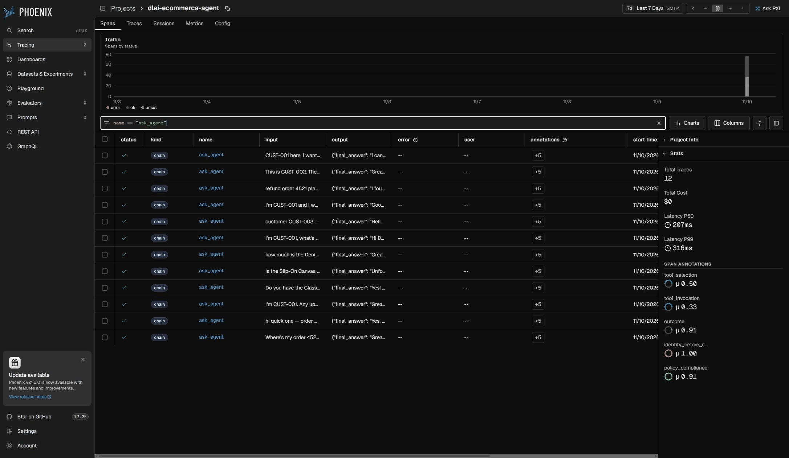

# Module 4: Evaluating Agent Actions and Outcomes

Original synthesis from saved local artifacts, reviewed on 14 November 2026. This review did not run the labs or verify unseen lectures.

## What this module demonstrates

An agent can produce a plausible answer while selecting the wrong tool, supplying incorrect arguments or failing to make the requested state change. This module separates those questions by reconstructing ordered tool trajectories and evaluating selection, invocation, refund outcomes and policy compliance independently.

The saved assignment contains completed exercise regions for required-tool coverage, expected-argument checks and identity-before-refund ordering. Phoenix annotations bring those layers back to the corresponding traces. The agent, database and surrounding lab workflow are course-provided.

## Observed evidence

The saved graded run contains 12 agent runs and 15 tool calls. All 20 code cells have execution counts, three exercise-test outputs pass, and no error output remains.

| Evaluation layer | Saved result |
| --- | --- |
| Required tool selection | 6 failures / 12 cases |
| Expected tool arguments | 8 failures / 12 cases |
| Refund outcome | 1 failure / 12 cases |
| LLM policy judgment | 11 compliant, 1 non-compliant |
| Phoenix logging | 5 annotations per span |

These layers measure different properties. The identity rule passes when no refund is attempted, so that pass does not prove task completion. The argument checker applies the lab's declared tool names and argument keys; its failure count is not a general measure of all possible valid tool strategies. The saved refund check consults shared database state; the database itself was not downloaded into this capture.

*Compare the same request across action, argument, outcome and policy annotations. A passing layer can coexist with a failure elsewhere in the workflow.*

## Artifacts and limits

Local-only original: `labs/m4-graded-lab-multi-layer-agent-evaluation/C1M4_Assignment.ipynb`. Five practice walkthrough GIFs and four graded Phoenix GIFs are present. See the [artifact manifest](../docs/ARTIFACTS.json), [saved results](../docs/RESULTS.md) and [environment limits](../docs/ENVIRONMENT.md).

No runnable practice notebook, course helper tree, database snapshot or dependency lock is present. The media demonstrates a separate practice capture; its numbers should not be substituted for the graded notebook's results. Lesson-note templates remain incomplete, and no platform grade or new rerun is claimed.

## Lesson index

The syllabus order follows the course capture of 4 November 2026. Documentation status is independent of platform completion.

| # | Lesson | Format | Capture status |
| --- | --- | --- | --- |
| 01 | [Evaluating the Work Behind a Response](notes/01-evaluating-the-work-behind-a-response.md) | Video | Pending verification |
| 02 | [Evaluating Actions and Tool Calls](notes/02-evaluating-actions-and-tool-calls.md) | Video | Pending verification |
| 03 | [Evaluating Trajectories](notes/03-evaluating-trajectories.md) | Video | Pending verification |
| 04 | [Evaluating Across Conversation Turns](notes/04-evaluating-across-conversation-turns.md) | Video | Pending verification |
| 05 | [Verifying Task Outcomes](notes/05-verifying-task-outcomes.md) | Video | Pending verification |
| 06 | [Interpreting Evaluation Results Together](notes/06-interpreting-evaluation-results-together.md) | Video | Pending verification |
| 07 | [Lab 1: Evaluate What the Agent Does](labs/lab-1-evaluate-what-the-agent-does/CAPTURE.md) | Code Example | Media only; notebook absent |
| 08 | [M4 Graded Lab: Multi-Layer Agent Evaluation](labs/m4-graded-lab-multi-layer-agent-evaluation/CAPTURE.md) | Graded・Code Assignment | Saved notebook inspected |
| 09 | [Module 4 Quiz](notes/09-module-4-quiz.md) | Graded・Quiz | Pending verification |
| 10 | [Module 4 Resources](notes/10-module-4-resources.md) | Reading | Pending verification |
