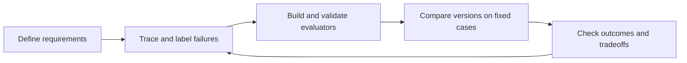

# Evaluating and Improving Agentic Applications

**From agent traces to measurable improvements.** Kaan Kaya's evidence-based learning journal for the [DeepLearning.AI course](https://www.deeplearning.ai/courses/evaluating-and-improving-agentic-applications), taught by Laurie Voss and built with Arize AI.

[Portfolio showcase](https://yasarkaankaya.com/showcase/agentic-evaluation/) - [Certificate](https://learn.deeplearning.ai/certificates/03976233-64c4-4195-a504-d5676a73f825) - [Verified findings](docs/RESULTS.md) - [Artifact inventory](docs/ARTIFACTS.json)

The Northwind Apparel scenario follows a support agent that searches a catalog, checks orders and handles refunds. The engineering question is whether its responses, tool calls, policy decisions and actual outcomes meet explicit requirements. A fluent, grounded answer can still leave a refund undone.

## Explore the learning journey

| Module | Problem and method | Saved evidence |
| --- | --- | --- |
| [1 - Foundations of evals](Module-01-foundations-of-evals/README.md) | Inspect behavior with local spans and Phoenix traces | 2 notebooks, 2 recordings |
| [2 - Observing and benchmarking](Module-02-observing-and-benchmarking-agents/README.md) | Turn requirements and failure labels into curated test cases | 1 notebook, 1 recording, benchmark archive |
| [3 - Evaluators you can trust](Module-03-building-evaluators-you-can-trust/README.md) | Combine code checks, model judges, rubrics and human-label validation | 1 notebook, 6 recordings |
| [4 - Actions and outcomes](Module-04-evaluating-agent-actions-and-outcomes/README.md) | Evaluate selection, invocation, trajectories, identity checks and outcomes separately | 1 notebook, 9 recordings |
| [5 - Improvements and regressions](Module-05-improving-agentic-applications/README.md) | Compare fixed cases, protect known-good behavior and capture production failures | 1 notebook, 4 recordings |

Inventory inspected **14 November 2026**: five module folders, 51 syllabus items, 11 listed labs, **6 saved notebooks and 22 standalone GIFs**. Five slide PDFs and one ZIP are also local. The ZIP contains six additional JPG captures, counted separately. A saved artifact does not prove a complete clean execution. Many lecture-note files remain labeled templates; the progress tracker preserves those gaps.

Kaan reports completing the final lab **30/30** and quiz **10/10** on 14 November 2026 and supplied the certificate link above. These are assessment grades, not agent-performance percentages. Certificate details were not independently verified during the static artifact audit.

## Evaluation workflow



The work uses Python notebooks, pandas, Arize Phoenix/OpenInference tracing, deterministic evaluators, model-based rubrics and agreement metrics. [Methods](docs/METHODS.md) maps methods to evidence; [environment notes](docs/ENVIRONMENT.md) distinguish observed imports from installed versions.

## What the evidence establishes

- **Evaluator reliability:** Module 3's final 12-case test reports 0.750 accuracy and Cohen's kappa 0.400 for both policy-judge versions. A separate perfect validation score follows changed human labels; it is not judge improvement.
- **Layered failures:** Module 4's 12-case table has 6 tool-selection failures, 8 invocation failures and 1 outcome failure. These overlapping counts describe a small test set, not production prevalence.
- **Comparison correctness:** Module 5's graded notebook aligns some rows by position. Matching saved raw frames by case identity yields **3/5 grounded for v1, v2 and v3**, with the same failing cases. Its apparent per-case improvement is unsupported.
- **Grounding versus completion:** A separate practice recording compares three failure cases and three known-good cases. v3 is grounded on the known-good cases but passes selection/outcome on only 2/3. It asks for confirmation where v2 completes the refund.
- **Preserved failures:** Module 2 retains a saved `RateLimitError`, documented as an incomplete attempt at that step.

See [results, sources and limitations](docs/RESULTS.md). No hosted labs were rerun for publication.

## A closer look


*Module 1: follow an agent request into its tool span. This excerpt omits notebook instructions and source code.*


*Module 5 practice snapshot: compare v2 and v3 against the same known-good cases. Grounding alone does not verify the requested action. [All four recordings and frame provenance](docs/MEDIA.md).*

## Reproduction and publication scope

The original hosted notebooks depend on course helpers, seeded data, model access and Phoenix. Those supporting packages and dependency locks are absent from this download. **This repository is not a complete local clone of the course runtime.** See [hosted versus local reproduction](docs/ENVIRONMENT.md).

An independently authored [identity-alignment notebook](experiments/identity-alignment.ipynb) and [Python example](experiments/identity_alignment.py) reproduce the comparison failure with synthetic data and no API calls:

```powershell
python experiments/identity_alignment.py
```

This command was tested with Python 3.11.9. Course notebooks were inspected, not rerun. Their original filenames, cell order and contents remain intact locally. The [manifest](docs/ARTIFACTS.json) records their hashes and saved error state. They are excluded from public Git with solutions, helpers, slides and raw archives because redistribution permission was not established.

## Attribution and authorship

The scenario, labs and teaching are **DeepLearning.AI / Arize AI course material**. This repository publishes Kaan's documented coursework evidence, original summaries and analysis, plus a publication-time synthetic example drafted with AI assistance. It does not claim authorship of the course agent or unseen lesson transcripts. Exercise work and publication-time analysis are distinguished in each capture.

No blanket license applies to third-party materials. [Attribution and publication review](docs/ATTRIBUTION.md), [progress](COURSE_PROGRESS.csv), [capture log](CHANGELOG.md) and [portfolio evidence](docs/PORTFOLIO_EVIDENCE.md) preserve what is verified, reported or missing.
