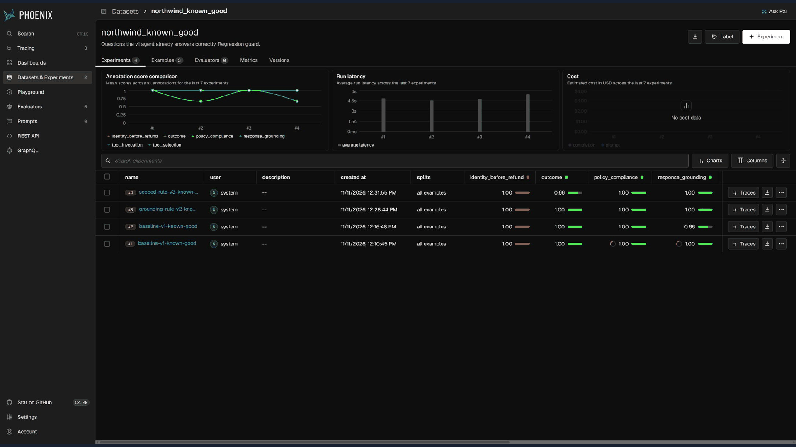
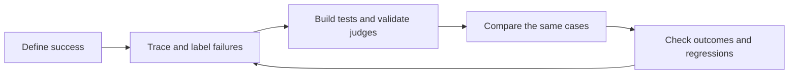

# Evaluating and Improving Agentic Applications

**Educational material | DeepLearning.AI coursework and original analysis by Kaan Kaya**

An AI agent can sound right and still get the job wrong. This technical learning repository follows the code and data needed to detect that: linked traces become benchmark cases, evaluators produce layered scores, and matched experiments expose regressions.

[Visual technical walkthrough](https://yasarkaankaya.com/showcase/agentic-evaluation/) | [Code and data contracts](docs/TECHNICAL_WALKTHROUGH.md) | [Course](https://www.deeplearning.ai/courses/evaluating-and-improving-agentic-applications) | [Certificate](https://www.deeplearning.ai/certificates/03976233-64c4-4195-a504-d5676a73f825)

## Follow the code through five stages

Each stage adds something the previous stage cannot establish. The public companion makes that progression executable on new synthetic requests, without API keys or external services.

| Stage | Receives | Adds | Passes forward | Source |
| --- | --- | --- | --- | --- |
| 1. Trace | A support request and replayed tool actions | Linked agent/tool spans and final state | An inspectable run | [m1_trace.py](technical_companion/m1_trace.py) |
| 2. Benchmark | Traced runs and expected requirements | Stable case identities, coverage and source-span provenance | Traceable benchmark cases | [m2_benchmark.py](technical_companion/m2_benchmark.py) |
| 3. Validate | Declared claims, evidence and separate reference/judge labels | Structured-fact checks and label-agreement measurement | Explicit evaluation rules and a validation report | [m3_evaluators.py](technical_companion/m3_evaluators.py) |
| 4. Evaluate | Cases, ordered tool calls and resulting state | Selection, argument, ordering, grounding, policy and outcome checks | A score vector for each case | [m4_outcomes.py](technical_companion/m4_outcomes.py) |
| 5. Compare | Baseline/candidate score vectors keyed by case ID | Paired comparisons and a gate across the protected evaluation layers | A decision backed by the same cases | [m5_compare.py](technical_companion/m5_compare.py) |

```powershell
python -m technical_companion
python -m unittest technical_companion.test_pipeline -v
```

The companion is independently authored educational code. It replays invented requests, including a $42 demo refund, and computes its own deterministic results. The recordings show separate saved **course runs**, including the $98 case below. The companion does not generate those recordings or reproduce their measurements. [Walk through the source, schemas and outputs](docs/TECHNICAL_WALKTHROUGH.md).

## Start with a refund

In one saved Northwind practice test, two prompt versions handled the same eligible refund request. One processed a **$98 refund**. The other asked for confirmation and left the refund incomplete.

Both passed checks for factual grounding and policy compliance.

| What the evaluator checked | Version 2 | Version 3 |
| --- | --- | --- |
| Were the response's claims supported? | Pass | Pass |
| Did the response comply with policy? | Pass | Pass |
| Was the expected refund completed? | Pass: $98 processed | Fail: confirmation requested |

This is a reconstruction of **one synthetic course case**, not a customer transcript. It comes from a saved practice comparison of three failure cases and three known-good cases. [Evidence and limitations](docs/RESULTS.md#practice-recording-protect-known-good-outcomes).



*Watch the response and its outcome score together. A supported answer does not establish that the requested action happened.*

## Why this matters

An agent combines a language model with tools that can look up information or take actions. Once it can inspect an order or issue a refund, a helpful-sounding answer is only part of its job.

Evaluation turns expectations into checks: what information must be verified, which actions should occur, what state should change, and which working behaviors a new version must preserve. It helps expose silent omissions and regressions that reading the final reply alone can miss.

The course builds this workflow around **Northwind Apparel**, a fictional support scenario. These notes explain the methods, inspect saved lab evidence and show where the measurements themselves need scrutiny.

## Five questions that build the workflow

| Question | What it teaches | Explore |
| --- | --- | --- |
| **1. What actually happened?** | Follow model and tool calls through a trace: a record of the agent's steps, inputs and outputs. | [Tracing and observability](Module-01-foundations-of-evals/README.md) |
| **2. Which requests should we test?** | Turn requirements and observed failures into a benchmark, then curate additional cases. | [Requirements and benchmarks](Module-02-observing-and-benchmarking-agents/README.md) |
| **3. Can we trust the scores?** | Validate code checks and model-based judges against reviewed reference labels. | [Evaluator reliability](Module-03-building-evaluators-you-can-trust/README.md) |
| **4. Did the agent do the right work?** | Check tool selection, arguments, policy, trajectories and task outcomes separately. | [Actions and outcomes](Module-04-evaluating-agent-actions-and-outcomes/README.md) |
| **5. Did the change really help?** | Compare the same cases, protect known-good behavior, inspect tradeoffs and turn failures into regression tests. | [Improvements and regressions](Module-05-improving-agentic-applications/README.md) |



## Two more lessons from the saved work

**The judge needs evaluation too.** In Module 3, each policy-judge version matches the reference label on **9 of 12 test cases**: 0.750 accuracy, with Cohen's kappa 0.400 for chance-adjusted agreement. These measure the judge's agreement with the labels, not the agent's task-success rate. An intermediate perfect validation score follows reference-label changes. That is a reason to inspect the labeling process, not evidence of a better judge.

**A comparison can create a false story.** The Module 5 graded notebook pairs some rows by position, even though experiment results arrive in a different order. Matching by case identity shows the same grounding result for all three versions: **3/5**, with the same failing cases. The apparent case-level improvement disappears. This graded experiment is separate from the refund practice example above.

These are small educational samples. They illustrate failure modes and evaluation methods; they do not establish production reliability or a general performance improvement. [Read the measurements and exact source locators](docs/RESULTS.md).

## Inspect the comparison failure in isolation

For a smaller example, the [independent synthetic notebook](experiments/identity-alignment.ipynb) isolates how reordered rows can invent a gain and a regression while aggregate scores remain unchanged. Its Python version requires only the standard library:

```powershell
python experiments/identity_alignment.py
```

The example checks case identity, duplicate cases and missing cases. It was prepared during publication with AI assistance and tested with Python 3.11.9. It does not call an LLM or reproduce the hosted course agent. [Environment and reproduction guidance](docs/ENVIRONMENT.md).

## Read, inspect and learn

- [Methods explained](docs/METHODS.md): what each check measures and where it can mislead.
- [Technical walkthrough](docs/TECHNICAL_WALKTHROUGH.md): source code, schemas, computed outputs and the handoff between modules.
- [Visual evidence](docs/MEDIA.md): five curated lab recordings with watchpoints and frame provenance.
- [Results and limitations](docs/RESULTS.md): measured observations, sample sizes and sources.
- [Artifact inventory](docs/ARTIFACTS.json): fingerprints of the original local evidence.

The public repository contains substantive notes, lab analyses, reviewed visual excerpts and the synthetic example. Empty lesson templates and internal course-capture records are kept locally rather than published.

## Course credit and scope

This is an **educational case study based on DeepLearning.AI's Evaluating and Improving Agentic Applications**, taught by Laurie Voss and built with Arize AI. The course provides Northwind, the agent and lab scaffolding. Kaan's coursework, original explanations and evidence analysis are distinguished from that material. The certificate confirms completion on **14 November 2026**.

Original course notebooks, assessment solutions, slides and raw downloads remain local because redistribution permission was not established. Missing helper packages and data snapshots also prevent a complete local reproduction of the hosted labs. No blanket license applies to third-party material. [Attribution and publication scope](docs/ATTRIBUTION.md).
