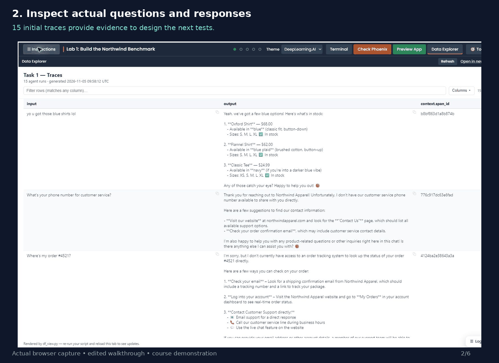

# Recorded lab walkthroughs

These five excerpts show the synthetic Northwind scenario in Phoenix and the hosted lab's Data Explorer. They document saved course screens. The [runnable technical companion](TECHNICAL_WALKTHROUGH.md) separately demonstrates the evaluation mechanics on new synthetic data; its output is not the source of these recordings. Original recordings remain local. [Frame selections and source hashes](MEDIA.json) identify every excerpt.

## Trace a request

Module 1: connection check, tool data and agent trace. Source frames 0, 2, 3, 5, 6; course notebook instruction/source panels omitted.

Watch the parent agent span, then its tool child. The tool's input and returned catalog data explain what evidence was available to the answer. A trace without an exception does not establish that the task succeeded. This stage supplies the run records that benchmark construction needs. [Code and input/output contract](TECHNICAL_WALKTHROUGH.md#module-1).

## Turn traced runs into benchmark cases

Module 2: source frames 2, 3 and 6. These are **Data Explorer tables derived from Phoenix traces**, rather than the Phoenix interface itself. Course source and instruction panels are omitted.

Watch `input`, `output` and `context.span_id` stay together as runs become reviewable rows. The final table adds category, severity and manual/synthetic provenance. It retains four selected scope-violation failures, each linked to its own span. Those failures form a regression set; they are not an estimate of production error frequency. This stage supplies stable cases and expected behavior for evaluator development. [Code and case schema](TECHNICAL_WALKTHROUGH.md#module-2).

## Inspect evaluator annotations

Module 3: inspect correctness, policy and product checks together. This screen is annotation evidence; the policy-judge validation statistics are separately sourced to the notebook in [RESULTS.md](RESULTS.md).

Watch the response beside each evaluator's label and explanation. A response can receive a positive correctness label while another check flags a different issue. The clip illustrates scored annotations; it does not show the held-out policy-judge validation report. That report separately compares judge labels with human references. [Code and evaluator validation](TECHNICAL_WALKTHROUGH.md#module-3).

## Compare evaluation layers

Module 4: see tool selection, invocation, outcome and policy on the same trace. Different checks can disagree legitimately.

Watch the layer annotations attached to the parent run alongside its actual steps. The selected course trace shows selection and policy scores of 0, but invocation, identity and outcome scores of 1. That request lacks customer identity: the expected outcome is **no refund**, and the identity-order check passes when no refund is attempted. Those positive labels do not mean a refund was completed or identity was verified. Reading the evaluator's exact rules is essential. The separately authored companion then demonstrates a different, identified eligible-refund case with explicit state checks. [Code and trajectory/outcome checks](TECHNICAL_WALKTHROUGH.md#module-4).

## Grounded does not mean completed

Module 5 practice: frames 3 and 4 of the latest comparison recording. v3's confirmation request remains grounded but leaves an action incomplete. Source notebook code/prompt panels are omitted.

Watch the same refund case in v2 and v3: one processes $98, the other asks for confirmation. Both are grounded and policy-compliant; the outcome differs. The known-good set therefore catches a regression that grounding alone misses. This practice run is separate from the graded notebook's row-alignment finding. [Code and paired regression checks](TECHNICAL_WALKTHROUGH.md#module-5).

All included frames were visually inspected. No credentials, authenticated URLs, real customer records or notebook solution code were observed. Visible customer/order identifiers belong to the synthetic course scenario. Static WebP posters accompany each GIF; the portfolio loads animations only after an explicit play action and provides stop controls. The unmodified raw files are not published.
