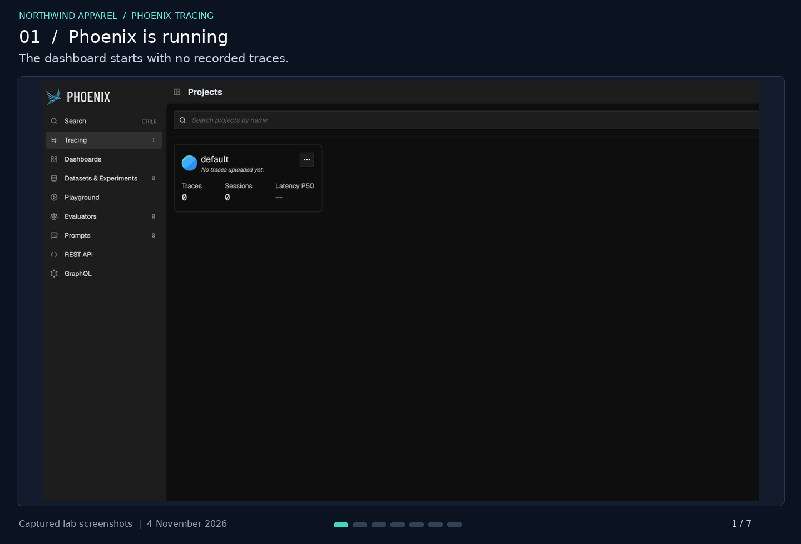
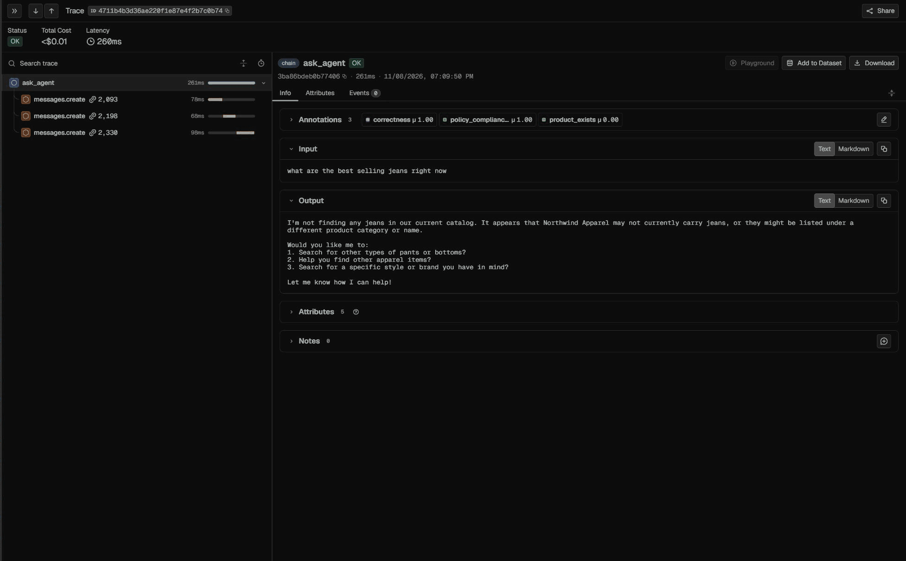
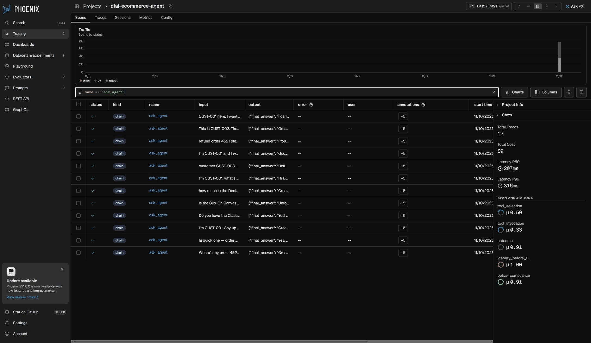
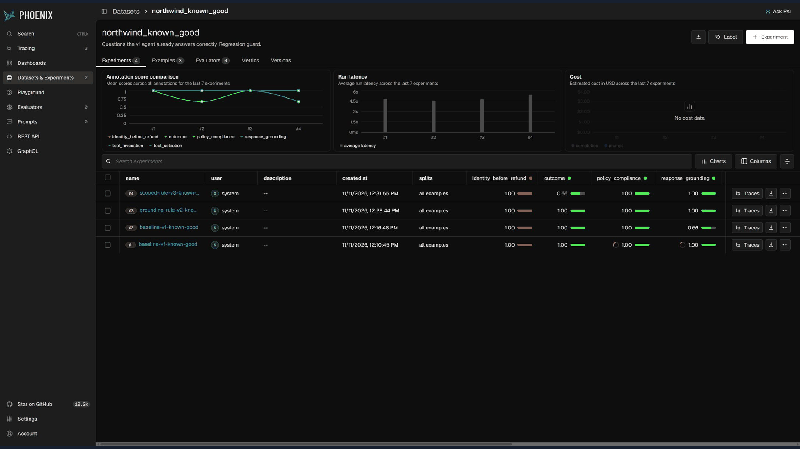

# Reviewed Phoenix gallery

These are excerpts of Kaan's saved coursework recordings, showing the synthetic Northwind scenario in Arize Phoenix. They document observed screens, not a fresh execution. Original recordings remain local. [Frame selections and source hashes](MEDIA.json) allow each excerpt to be traced to the original.

## Trace a request

Module 1: connection check, tool data and agent trace. Source frames 0, 2, 3, 5, 6; course notebook instruction/source panels omitted.

## Inspect evaluator annotations

Module 3: inspect correctness, policy and product checks together. This screen is annotation evidence; the policy-judge validation statistics are separately sourced to the notebook in [RESULTS.md](RESULTS.md).

## Compare evaluation layers

Module 4: see tool selection, invocation, outcome and policy on the same trace. Different checks can disagree legitimately.

## Grounded does not mean completed

Module 5 practice: frames 3 and 4 of the latest comparison recording. v3's confirmation request remains grounded but leaves an action incomplete. Source notebook code/prompt panels are omitted.

All included frames were visually inspected. No credentials, authenticated URLs, real customer records or notebook solution code were observed. Visible customer/order identifiers belong to the synthetic course scenario. Static WebP posters accompany each GIF; the portfolio loads animations only after an explicit play action and provides stop controls. The unmodified raw files are not published.
