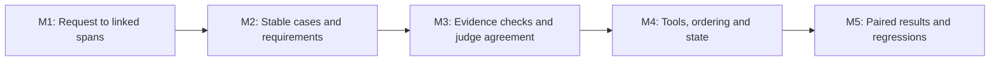

# Technical walkthrough: one request, five evaluation layers

**Educational material.** This independently authored Python companion explains the mechanics behind the course workflow. It was prepared with AI assistance during publication. It uses invented `DEMO-*` records and a **$42** refund, not the course's saved questions, assignment solutions or $98 practice case.

The code is a **deterministic replay**, not a live language-model agent, a Phoenix client or a new course experiment. The saved Phoenix recordings show separate hosted course runs. Read a code stage to understand the operation, then inspect the corresponding course capture to see where that operation matters in a real tracing/evaluation workspace.

## Run the whole pipeline

From the repository root, using Python 3.11 or newer and only the standard library:

```powershell
python -m technical_companion
python -m unittest technical_companion.test_pipeline -v
```

These commands were executed with Python 3.11.9. The fourteen behavior tests pass. No install command, credentials, model calls, network service or hidden course helpers are needed.

```text
Independent synthetic companion; not a course run or production measurement.
M1 trace: DEMO-REFUND baseline; 4 linked spans; 1 refund record(s)
M2 benchmark: 3 unique cases joined to source traces; 3/3 declared requirements covered
M3 evaluators: grounded=True; fixed judge labels match 3/4; kappa=0.500
M4 candidate refund: {'grounding': True, 'selection': False, 'invocation': True, 'ordering': True, 'outcome': False, 'policy': True}
M5 paired outcomes: baseline=3/3; candidate=2/3; regressions=['DEMO-REFUND']; gate_passed=False
```

The final line is the consequence of the earlier stages: the candidate's supported confirmation request does not create a refund record. Its case identity connects the missing action to the original requirement and the version comparison. The baseline traces establish the observed working behavior that the candidate is expected to preserve.

[sample-output.json](../technical_companion/sample-output.json) is an actual computed export with fixture identifier `synthetic-companion-v1`, interpreter version and stage outputs. Regenerate JSON on stdout with `python -m technical_companion --json`.

## How the modules connect



| Stage | Input | New capability | Output used by the next stage |
| --- | --- | --- | --- |
| 1 | An invented support case and version | Expose the actions behind a response | A `Run` with linked spans, structured claims and resulting state |
| 2 | Cases, declared requirements and Module 1 runs | Join observed behavior with expectations, identity and coverage | Trace-linked benchmark entries keyed by unique `case_id` |
| 3 | Run evidence; separate fixed judge/reference labels | Check factual claims and inspect measurement agreement | A narrow grounding check and agreement metrics |
| 4 | A benchmark case and its run | Separate facts, tool behavior, action order and task completion | One score vector per case |
| 5 | Baseline/candidate score vectors | Pair identical cases and protect all declared layers | Layer regressions, paired outcome counts and a gate decision |

Shared contracts are in [models.py](../technical_companion/models.py). Invented cases and fixed validation labels are in [fixtures.py](../technical_companion/fixtures.py). The executable composition is [__main__.py](../technical_companion/__main__.py).

## Module 1

### A response becomes an inspectable run

Source: [m1_trace.py](../technical_companion/m1_trace.py).

`replay(case, version)` returns a `Run`. Its root span represents the request; each tool span points to that root through `parent_id`, receives a sequence number and retains structured inputs/outputs. The resulting state is kept alongside the response.

```python
root_id = f"{version}/{case.case_id}"
tools: list[Span] = []
state: dict = {"refunds": []}

def record(name: str, inputs: dict, outputs: dict, milliseconds: int) -> None:
    tools.append(Span(f"{root_id}/{len(tools) + 1}", root_id, name,
                      len(tools) + 1, inputs, outputs, milliseconds))
```

For `DEMO-REFUND`, the baseline records `lookup_order`, `verify_identity` and `issue_refund`. The run has four spans including the root and one $42 refund record. Later, the candidate uses the same replay interface but omits the refund operation and asks for confirmation instead. Keeping the baseline trace makes that lost behavior inspectable.

The span IDs are deterministic for this teaching replay. A live implementation would need collision-safe run IDs, real instrumentation, error capture and concurrency handling. The `synthetic_ms` values are invented fixtures; they are not latency measurements.

**Watch the saved course GIF:** [Module 1 trace excerpt](MEDIA.md#trace-a-request). Follow the parent request into its child tool span and inspect the input/result. That is the context an answer-only check loses. The [course lab analysis](../Module-01-foundations-of-evals/labs/m1-graded-lab-tracing-the-northwind-apparel-agent-with-phoenix/CAPTURE.md) explains the actual Phoenix instrumentation work.

**What Module 2 adds:** a trace shows what happened once. A benchmark states which behavior should be tested again.

## Module 2

### A traceable case becomes a benchmark expectation

Source: [m2_benchmark.py](../technical_companion/m2_benchmark.py).

`build_benchmark(cases, runs)` consumes Module 1's observed runs. It rejects duplicate IDs, missing/wrong observations and missing declared requirement categories. Each `BenchmarkEntry` joins a case's expectations to its actual source run, retaining the root span ID and observed response.

```python
for run in runs:
    if run.case_id in observations:
        raise ValueError(f"Duplicate observed case: {run.case_id}")
    observations[run.case_id] = run
if set(expectations) != set(observations):
    raise ValueError("Observed runs must cover exactly the expected case identities")
covered = {case.requirement for case in expectations.values()}
missing = REQUIRED_COVERAGE - covered
if missing:
    raise ValueError(f"Missing requirement coverage: {sorted(missing)}")
```

The three invented cases cover an eligible refund, an order-status request and an expired-refund refusal. Two are tagged `known_good`; one is `targeted`. The eligible and expired cases deliberately share the same request text. Their distinct IDs survive reordering, so prompt text does not become the join key. For example, the eligible case retains source root span `baseline/DEMO-REFUND` and observed response `The $42 demo refund is recorded.`

The resulting **3/3 coverage** means only that these three declared requirement categories are present. It says nothing about production prevalence, linguistic variety or sufficient sample size. Curation and representative sampling remain human design decisions.

**Watch the saved course GIF:** [Module 2 trace-to-benchmark tables](MEDIA.md#turn-traced-runs-into-benchmark-cases). The hosted Data Explorer keeps input, output and source span ID together, then adds labels and provenance to the selected failures. These tables are derived from Phoenix traces; they are not the Phoenix interface itself.

The [Module 2 practice analysis](../Module-02-observing-and-benchmarking-agents/labs/lab-1-build-the-northwind-benchmark/CAPTURE.md) follows trace extraction, failure labels, synthetic-query curation and a four-case regression set. The [graded analysis](../Module-02-observing-and-benchmarking-agents/labs/m2-graded-lab-error-analysis-and-synthetic-test-data/CAPTURE.md) is a different dataset and preserves a rate-limit error rather than claiming a clean rerun.

**What Module 3 adds:** cases express expectations. Evaluators turn those expectations into scores, and the scores themselves need validation.

## Module 3

### Score a declared fact, then check the judge's agreement

Source: [m3_evaluators.py](../technical_companion/m3_evaluators.py).

`grounding_score(run)` gathers structured tool evidence and checks the run's explicitly declared factual claims:

```python
evidence = {}
for span in run.tools:
    evidence.update(span.outputs)
return all(key in evidence and evidence[key] == value
           for key, value in run.claims.items())
```

This is a **narrow exact-fact rule**, not a general natural-language faithfulness judge. It does not parse the response, infer missing actions or evaluate an unrestricted explanation. A run with no factual claims can pass this check while leaving the task unfinished. The tests deliberately add an unsupported `refunded_amount` claim to the candidate and verify that this rule fails it.

`judge_agreement(reference, predicted)` demonstrates the separate validation operation. It aligns four fixed synthetic labels by ID, checks complete membership, computes observed agreement and adjusts it for expected chance agreement:

```python
accuracy = sum(reference[key] == predicted[key] for key in reference) / total
reference_positive = sum(reference.values()) / total
predicted_positive = sum(predicted.values()) / total
chance = (reference_positive * predicted_positive
          + (1 - reference_positive) * (1 - predicted_positive))
kappa = None if chance == 1 else (accuracy - chance) / (1 - chance)
```

The fixture gives **3/4 agreement, accuracy 0.750 and kappa 0.500**. These are newly executed synthetic demonstration values, not the course's 12-case policy-judge results. Fixed exported decisions illustrate metric mechanics; no LLM was called or calibrated here. The implementation returns `None` for kappa when chance agreement is one and the statistic is undefined.

In the actual course, rubric-based model judges are compared with reviewed reference labels and held-out cases. Their saved results are [9/12 agreement and kappa 0.400](RESULTS.md#module-3---validate-the-policy-judge). A perfect intermediate score follows reference-label changes, not demonstrated evaluator improvement.

**Watch the saved course GIF:** [Module 3 annotations](MEDIA.md#inspect-evaluator-annotations). Inspect the rule, label and explanation beside the response. The displayed correctness annotations are a different layer from the notebook's policy-judge agreement statistics.

**What Module 4 adds:** supported facts do not establish correct tools, safe action order or a completed refund.

## Module 4

### Check the trajectory and resulting state

Source: [m4_outcomes.py](../technical_companion/m4_outcomes.py).

`evaluate_run(case, run)` first verifies the same case identity, then produces independent checks for grounding, selection, invocation, ordering, outcome and policy. Its ordering rule asks whether a verified identity precedes every refund operation:

```python
identities = [span.sequence for span in tools
              if span.name == "verify_identity" and span.outputs.get("verified") is True]
refunds = [span for span in tools if span.name == "issue_refund"]
ordering = all(any(verified < refund.sequence for verified in identities) for refund in refunds)
matching_refunds = [row for row in run.state["refunds"]
                    if row["order_id"] == case.order_id and row["refunded_amount"] == case.amount]
if case.requirement == "complete_refund":
    outcome = bool(matching_refunds)
```

For the candidate's eligible refund, grounding and policy pass, but selection and outcome fail. Invocation checks the calls that exist; selection detects the missing required refund call. Ordering passes when no refund operation is attempted. Neither vacuous pass proves identity verification or completion.

The outcome rule checks a matching state record, so a successful-looking tool result alone is insufficient. One negative test keeps the refund tool span but removes its resulting state record; the outcome check correctly fails. Another moves the refund before identity verification and checks that ordering/policy fail.

These are intentionally small explicit rules, not a complete retail policy engine. Their semantics are visible so a reader can challenge what a pass actually means.

**Watch the saved course GIF:** [Module 4 layered annotations](MEDIA.md#compare-evaluation-layers). Read tool, policy and outcome scores on the same trace. For the selected course request, an outcome pass means the expected no-refund behavior occurred; it does not mean a refund was completed. The identity-order check also passes without a refund call. The [course capture](../Module-04-evaluating-agent-actions-and-outcomes/labs/m4-graded-lab-multi-layer-agent-evaluation/CAPTURE.md) documents its actual expected-argument and shared-database semantics, which are not reproduced by this in-memory fixture.

**What Module 5 adds:** one score vector becomes useful for improvement only when it is paired with the same cases from another version.

## Module 5

### Compare fixed identities and surface the regression

Source: [m5_compare.py](../technical_companion/m5_compare.py).

`compare_versions(baseline, candidate)` rejects differing or empty case sets and incomplete/non-Boolean score vectors. It pairs by key and protects all six declared layers, including policy and ordering:

```python
if not baseline or set(baseline) != set(candidate):
    raise ValueError("Version comparisons require identical, nonempty case sets")
paired = {case_id: {"baseline": baseline[case_id], "candidate": candidate[case_id]}
          for case_id in baseline}
layer_regressions = {
    case_id: [layer for layer in PROTECTED_LAYERS
              if pair["baseline"][layer] and not pair["candidate"][layer]]
    for case_id, pair in paired.items()
}
layer_regressions = {key: layers for key, layers in layer_regressions.items() if layers}
```

The runner deliberately reverses candidate completion order. Identity pairing still finds `DEMO-REFUND`: baseline outcomes **3/3**, candidate outcomes **2/3**, with regressions in `selection` and `outcome`. The gate returns `False`. Aggregate grounding alone would miss the lost action.

A separate negative test keeps the outcome passing but changes ordering/policy from pass to fail. The gate still fails. Protecting only outcome counts would let that policy regression through.

Here, `gate_passed` means **no protected pass became a failure**. It is not an absolute quality check or production release approval: if both versions already fail a layer, there is no new regression. A test compares the same imperfect version with itself and confirms the guard can pass while only 2/3 outcomes succeed.

No synthetic version is being recommended as a generally better prompt. These three invented cases are a demonstration of the comparison operation. For an actual release decision, expand coverage, validate evaluators, define acceptance criteria before testing, and inspect repeated quality/cost/latency measurements.

**Watch the saved course GIF:** [Module 5 refund comparison](MEDIA.md#grounded-does-not-mean-completed). The course recording's refund is $98 and its practice test has three failure plus three known-good cases; it is separate from this $42 replay. Separately again, the graded notebook's row-position comparison misattributes case changes. [Its identity-corrected saved results](RESULTS.md#graded-notebook-compare-by-identity) remain 3/5 grounded for all versions.

The older [identity-alignment notebook](../experiments/identity-alignment.ipynb) isolates the row-order pitfall in an even smaller standalone example. This companion extends that idea into a cumulative trace-to-regression workflow.

## Validation and limits

[test_pipeline.py](../technical_companion/test_pipeline.py) contains fourteen checks covering trace linkage, source joins with repeated prompts, duplicate/missing/wrong observations, benchmark coverage, unsupported claims, judge-label membership and ordering, missing state effects, refund-before-identity policy failure, reordered comparisons, missing cases and incomplete score vectors. They include a policy regression with a passing task outcome, an undefined kappa case, and unchanged failures that do not count as new regressions.

The code makes its behavior reproducible through explicit fixtures. It does not reconstruct unavailable course helpers, run a live agent, establish production reliability or rerun a graded assignment. [Course environment limits](ENVIRONMENT.md) and [attribution](ATTRIBUTION.md) describe the separate saved evidence.
